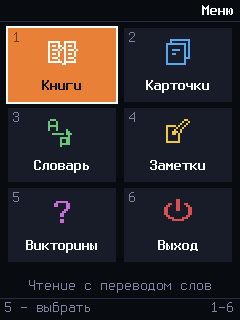
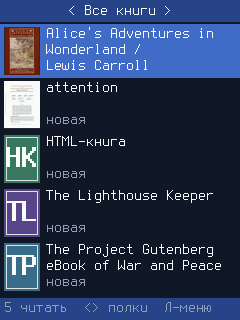
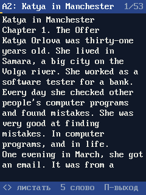
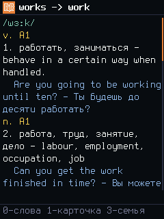
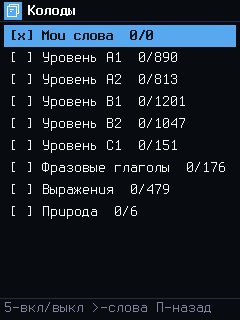
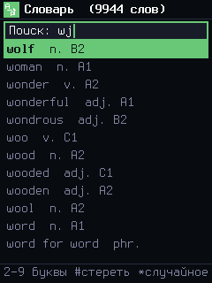
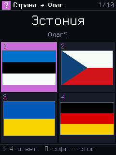
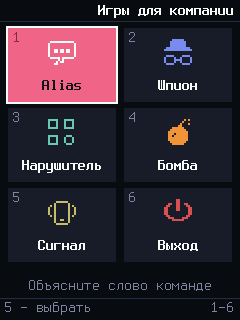

# Свои программы для кнопочного телефона BQ 3590 Step XXL+

Обычный кнопочный телефон превращается в карманную читалку и тренажёр английского:
книги с переводом слова по нажатию клавиши, карточки с интервальным повторением, словарь,
викторины, игры для компании, Doom и эмуляторы старых приставок. Телефонная прошивка остаётся
на месте: без зажатой клавиши телефон включается как обычно, звонит и пишет SMS.

Это голый C без операционной системы на чипе Spreadtrum SC6531E: ARM926 208 МГц без FPU,
4 МБ ОЗУ, экран 240×320. Программы лежат на SD-карте и запускаются при включении телефона
сочетанием клавиш. Основа — среда [fpdoom](https://github.com/ilyakurdyukov/fpdoom) Ильи
Курдюкова.

<p>








</p>

*Снимки сделаны в эмуляторе на ПК, они же — эталоны автотестов (`tests/golden/`).*

## Что умеет

| Программа | Что умеет |
|---|---|
| Книги | читалка: полка с обложками и категориями, учебники и книги с таблицами, формулами и картинками, PDF; перевод английского слова, оглавление, поиск, закладки и цитаты, подложки |
| Карточки | интервальное повторение слов как в Anki; колоды как в ReWord: уровни A1-C1, фразовые глаголы, выражения, свои темы и «Мои слова» из словаря и книг включаются и выключаются, у каждой прогресс и список слов со статусами; обмен с Anki |
| Словарь | англо-русский учебный словарь на ~4100 слов и ~650 фраз: часть речи, уровень, значения, примеры; в книге «gave it up» находит «give up» |
| Заметки | заметка на строку, набор с клавиатуры телефона |
| Викторины | страны и столицы, флаги, валюты; своя викторина — таблица в `sources/quiz/`, без кода |
| Игры для компании | на одном телефоне: Alias (объясни слово команде, слова из наборов A1–C1), Шпион, Нарушитель, Бомба; сигнал вибрацией или подсветкой клавиш |
| Doom | shareware Doom 1 (по желанию, без звука), порт fpdoom |
| Эмуляторы | Game Boy (gnuboy), NES (InfoNES), SNES (Snes9x) — порты fpdoom |
| Головоломки | 40 головоломок Саймона Тэтхэма |

## Мультизагрузчик: программа на сочетание клавиш

Каждая программа — отдельный файл в `fpbin/` на карте, и в памяти всегда только одна из них.
Какую запустить, выбирает сочетание клавиш, зажатых при включении телефона:

| Клавиши при включении | Что запускается |
|---|---|
| левая софт-клавиша (LSOFT) | меню: книги, карточки, словарь, заметки, викторины |
| `4` | Doom |
| `1` | игры для компании |
| `1`+`2` | Game Boy: Tobu Tobu Girl Deluxe |
| `1`+`5` | Game Boy: Deadeus |
| `1`+`6` | головоломки |
| без клавиши | обычная прошивка телефона |

Как это работает:

1. **sdboot** — 4 КБ кода, дописанные в свободное место прошивки. При включении он проверяет
   клавишу и, если она зажата, запускает с карты `fpbin/fpmain.bin`.
2. **Загрузчик** `fpbin/fpmain.bin` (`fpdoom/launcher/`) читает с клавиатуры все зажатые клавиши
   (до четырёх, в любом порядке) и ищет строку с таким сочетанием в `fpbin/config.txt`.
3. Найденную программу он загружает **поверх себя** и передаёт ей управление. Программа получает
   всю память телефона (~4 МБ): ни меню, ни загрузчик в ней не остаются.

Поэтому программ на карте может быть сколько угодно, и ни одна не отнимает память у других.
Doom, эмулятор SNES или 40 головоломок не урезают читалку, а читалка не мешает им. По той же
причине игры для компании вынесены из меню в отдельную программу (`fpbin/party.bin`): меню не
держит их код и данные.

Новая программа — одна строка в `fpdoom/launcher/config.txt`, без пересборки загрузчика:

```
|LSOFT| fpbin/apps.bin $@ apps
|4|     fpbin/doom.bin $@ --rotate 3 --dir games/doom1 doom
|1+2|   fpbin/gnuboy.bin $@ --rotate 3 --dir games/gb gnuboy tobudx.gb
|1+9|   fpbin/snes9x.bin $@ --rotate 3 --scaler 149 --dir games/snes snes9x --crc 0 --nocheck ROM.sfc
```

Правила:
- Первой зажимается клавиша sdboot. На BQ 3590 это LSOFT, `1` или `4`; на другом телефоне их
  покажет `fphelper flash.bin scan`. Вторую клавишу можно нажать сразу после первой. Удобнее
  всего `1`+любая цифра.
- Незнакомое сочетание — пробуются клавиши по одной, затем строка `|default|` (меню).
- Нет программы на карте — телефон перезагружается в обычную прошивку.

## Как сделать самому

Проверено на BQ 3590 Step XXL+ (SC6531E, прошивка `C75_F19_BQ3590_20250808_V105`). Другие
телефоны на SC6531E/SC6531DA/SC6530 скорее всего подойдут: адреса для sdboot считаются по
дампу именно вашей прошивки.

**1. Окружение.** Linux, Android NDK r25b (`~/opt/android-ndk-r25b`, путь меняется через `NDK=`),
`libusb-1.0-0-dev`, Python 3 с Pillow и markdown-it, `poppler-utils` (PDF), SDL2 (эмулятор).
Затем `make venv` (окружение `.venv` с matplotlib для формул) и правило udev для доступа к
телефону по USB без root, в `/etc/udev/rules.d/80-spd.rules`:

```
SUBSYSTEMS=="usb", ATTRS{idVendor}=="1782", ATTRS{idProduct}=="4d00", MODE="0666", TAG+="uaccess", ENV{ID_MM_DEVICE_IGNORE}="1"
```

затем `sudo udevadm control --reload-rules`. Сборка: `make tools sdboot`.

**2. Попробовать без телефона.** `make test` или `make pctest` — меню в окне на ПК.

**3. Режим загрузки по USB.** Вынуть и вставить батарею, зажать зелёную кнопку (DIAL) и
подключить кабель. Каждая команда `spd_dump` ниже ждёт телефон в этом режиме.

**4. Сохранить дамп прошивки.** Это единственный способ вернуть телефон, если что-то пойдёт не так.
Храните дамп вне репозитория.

```
spreadtrum_flash/spd_dump fdl spreadtrum_flash/custom_fdl/nor_fdl1.bin 0x40004000 \
  read_flash 0x80000003 0 4M flash.bin
```

**5. Установить sdboot.** `spreadtrum_flash/fphelper/fphelper flash.bin scan` покажет клавиши
sdboot, `fphelper flash.bin sdboot` — команды записи именно для вашей прошивки (бинарник —
`fpdoom/sdboot/sdboot1.bin`). Запись во flash меняет вектор запуска и один свободный
блок 4 КБ; там же выводится команда удаления. Команды для прошивки V105 и как их
проверяли — в `docs/hardware.md`. Проверить карту, ничего не записывая во flash: `make sdtest`.

**6. Карта.** FAT32 в первом разделе MBR с меткой `BQ3590` (форматирование стирает карту),
например через телефон в режиме накопителя:

```
echo type=c | sudo sfdisk /dev/sdX
sudo mkfs.vfat -F 32 -n BQ3590 /dev/sdX1
```

**7. Программы и данные.** `make sdcard`, затем скопировать содержимое `sdcard/` в корень карты.
Дальше обновлять через `make update` (см. ниже). Doom, эмуляторы и головоломки собираются
отдельно — см. «Игры и программы».

Без sdboot меню можно запускать по кабелю: `make run` (файлы читаются с компьютера из
`phone-data/`).

## Команды

| Команда | Что делает |
|---|---|
| `make tools` | утилиты USB: `spd_dump`, `spd_dump_fast`, `libc_server`, `fphelper`, `nor_fdl1.bin` |
| `make sdboot` | `fpdoom/sdboot/sdboot1.bin` для записи во flash |
| `make apps` / `make apps-sd` | программа для работы по кабелю / с SD-карты |
| `make party` | игры для компании, отдельная программа `fpbin/party.bin` |
| `make data` | словарь, наборы слов и книги из `sources/` в `phone-data/` |
| `make ports` | игры и программы из таблицы выше (нужны исходники, см. «Игры и программы») |
| `make sdcard` | содержимое SD-карты в `sdcard/` |
| `make update-data` | книги, колоды, словарь, викторины и списки игр: собрать и записать на карту телефона, подключённого как накопитель |
| `make update-code` | только программы (`fpbin/`), без сборки данных |
| `make update` | обе команды за одно подключение |
| `make run` | загрузить меню в память телефона по кабелю |
| `make sdtest` | запустить меню с карты через кабель, ничего не записывая во flash |
| `make pctest` | меню в окне на ПК: `cd phone-data && ../fpdoom/apps/apps_pc.bin --res 240 320` |
| `make test` | тесты: книги (`tests/test_books.py`) и сценарии клавиш в эмуляторе со снимками экрана |
| `make testdl` | скачать PDF для тестов (`tests/downloads.txt`) в `dl/books/` |

## Обновление карты

`make update` (или `update-data` / `update-code`), затем подключить телефон кабелем в режиме
накопителя или вставить карту в картридер (карта находится по метке `BQ3590`). Файлы сравниваются с картой по имени и размеру, с карты ничего не перечитывается:
новые записываются, файл другого размера удаляется и записывается заново (об этом пишется). С карты
ничего не удаляется само: книги, положенные туда иначе, остаются на полке. Книгу удаляют с телефона:
меню книги на полке (Л-софт) → «Удалить»; она уходит на полку «На удаление», а следующий
`make update-data` удаляет её с карты и переносит её исходник в `sources/deleted/`. Прогресс
чтения, закладки и цитаты (`state/`) и карточки (`cards.txt`) не трогаются.

## Игры и программы

Исходники и данные игр не входят в репозиторий; файлы игр лежат в `games/` и копируются на
карту в `games/`. Один раз скачать исходники:

```
cd fpdoom
make -C gnuboy -f helper.make all patch
make -C infones -f helper.make all patch
make -C snes9x -f helper.make all patch
make -C puzzles -f helper.make
make -C softfp -f helper.make     # плавающая точка для ARM926 (compiler-rt)
cd ..
make ports update
```

Doom:

```
git clone --depth 1 https://github.com/id-Software/DOOM.git /tmp/DOOM
cp -r /tmp/DOOM/linuxdoom-1.10 fpdoom/doom_src
patch -d fpdoom/doom_src -p1 -i ../doom.patch
# doom1.wad (shareware 1.9, md5 f0cefca49926d00903cf57551d901abe) — из пакета Debian
# doom-wad-shareware: dpkg-deb -x doom-wad-shareware_*.deb x
mkdir -p games/doom1 && cp x/usr/share/games/doom/doom1.wad games/doom1/
```

Файлы игр (все бесплатные):

| Куда | Что | Откуда |
|---|---|---|
| `games/gb/tobudx.gb` | Tobu Tobu Girl Deluxe (бесплатно) | tangramgames.itch.io/tobu-tobu-girl-deluxe, файл `tobudx.gb` |
| `games/gb/deadeus.gb` | Deadeus 1.4 (бесплатно) | izma.itch.io/deadeus, `Deadeus.gb` из архива Regular Edition |

Свои ROM кладутся туда же; имя файла меняется в `fpdoom/launcher/config.txt`.
NES и SNES в конфиге не заняты; ROM кладётся в `games/nes` или `games/snes`, а в конфиг
добавляется строка (клавиши — любые свободные):

```
|1+3| fpbin/infones.bin $@ --rotate 3 --scaler 49 --dir games/nes infones ROM.nes
|1+9| fpbin/snes9x.bin $@ --rotate 3 --scaler 149 --dir games/snes snes9x --crc 0 --nocheck ROM.sfc
```

Игры для компании: сигнал (вибрация, подсветка клавиш или без него) выбирается в их меню, общий
для всех игр. Alias: `5` — угадали, `#` — пропуск, Л.софт — пауза; команды, время хода, очки до
победы, уровень и язык слов, штраф за пропуск — в «Настройках» игры. Шпион — режимы «Место», «Два
слова» (у шпиона похожее слово), «Без слова», «С ограничением» (у каждого своё ограничение на
ответы); Нарушитель — «Правило» (поведения) и «Задание» (вопрос), у нарушителя похожее. У обеих в
настройках режим, число игроков и шпионов/нарушителей, минуты на обсуждение. Бомба: границы
случайного времени до взрыва. Настройки хранятся в `state/`, списки — в `sources/party/` (на карте
`party/`), по одному в строке, пары похожих — через табуляцию.

Управление в головоломках: стрелки — курсор, центр и `*` — действие, цифры — числа, RSOFT — отменить ход, LSOFT — меню.

## Книги

Книга кладётся в `sources/books/`, папка внутри неё — категория на полке (`sources/books/Учебники/`).
`make update-data` готовит книги на ПК и записывает на карту. Форматы: `.epub`, `.fb2`, `.fb2.zip`,
`.md`, `.html`, `.txt`, `.pdf`, `.djvu`. Книга пересобирается, только когда изменились она сама или
инструменты её формата; несколько книг (и страницы большой PDF) собираются на нескольких ядрах.

Книгу раскладывает под экран `tools/mkbook.py` (формат файла: `tools/bookfile.py`): заголовки,
жирный, курсив, переносы, списки, цитаты, код, таблицы (широкие — картинкой, из двух столбцов —
списком, со строкой выше страницы — списком), картинки и формулы в цвете, обложка. Две книги,
которые получили бы одно имя файла (`A/Книга.epub` и `B/Книга.epub`), останавливают сборку:
переименуйте одну. Телефон читает с карты по одной странице, размер
книги ограничен только картой. PDF с текстовым слоем (набранный или скан с OCR) читается как
текст (`tools/pdfparse.py`): заголовки по размеру шрифта и закладкам PDF, абзацы, списки, жирный и
курсив, колонтитулы убираются, рисунки, графики и таблицы вырезаются картинками с подписями.
Сканы без текста и DjVu перекомпоновывает [k2pdfopt](https://www.willus.com/k2pdfopt/):
строки, формулы и рисунки страницы раскладываются заново в картинки размером с экран. Нужен файл
`dl/k2pdfopt` (сборка для Linux с сайта автора; пакет Ubuntu 2.55 падает). Размер текста —
`k2pdfopt_dpi` в `CONF` (`tools/mkbook.py`). В DjVu (обычно это сканы) нет поиска и
оглавления, название книги берётся из имени файла.
Проверить раскладку без телефона: `.venv/bin/python3 tools/bkview.py КНИГА.bk папка/`.

Клавиши в книге:

| Клавиша | Что делает |
|---|---|
| `4`/`6`, стрелки | страница назад / вперёд; `1`/`3` — на 10 страниц |
| `5` | выбрать слово (стрелки — по словам), `5` — перевод с английского, `1` в статье — в карточки |
| `*` | закладка на странице; на выбранном слове — начало цитаты, `5` на последнем слове — сохранить |
| `#` | найти выбранное слово дальше; без выбора — следующее совпадение поиска |
| `5` на картинке | во весь экран: стрелки двигают, `5` — масштаб ×1, ×2, ½ |
| Л.софт | меню: оглавление, страница, поиск, закладки и цитаты, вид (подложка, яркость), клавиши |
| П.софт | назад |

На полке `<`/`>` — полки «Читаю», «Все книги», «Прочитано» и категории; `5` открывает книгу на
месте, где остановились; Л.софт — отметить прочитанной или читать с начала.

Состояние на карте: `state/<id>.pos` (место и статус книги, у каждой свой файл), `state/<id>.txt`
(закладки и цитаты), `state/reader.txt` (подложка и яркость). Состояние убранной из `sources/`
книги остаётся на карте и вернётся вместе с ней. Телефон не создаёт папки, `state/` делает
`make sdcard`.

## Добавить словари

```
python3 tools/mkdict.py phone-data/dict.bin sources/lexicon fpdoom/apps/words.txt [СЛОВАРЬ.ifo]
python3 tools/anki.py import phone-data КОЛОДА.apkg
```

## Добавить колоду по теме

Положить `.apkg` из Anki или таблицу `.txt` («слово<TAB>перевод[<TAB>пример]») в
`sources/decks/` под именем темы (`sources/decks/Еда.apkg`) и выполнить `make data`. Колода
появится в «Карточки → Колоды»; если в ней у знакомого слова другое значение, оно допишется к
карточке и слово один раз придёт на повторение.

## Устройство

- `fpdoom/apps/` — программы (C): меню, книги (`shelf.c` полка, `reader.c` чтение, `book.c`
  формат, `marks.c` закладки), карточки, словарь, заметки; игры для компании (`party.c`: `alias.c`, `roles.c`, `bomb.c`) — отдельная программа
- `fpdoom/launcher/` — загрузчик: выбор программы по клавише при включении (код запуска из `fpdoom/fpmenu/`)
- `fpdoom/term/` — текстовый экран для меню портов, недостающие функции libc
- `fpdoom/softfp/` — плавающая точка и `math.h` (у ARM926 нет FPU, библиотека NDK — для ARMv7)
- `fpdoom/puzzles/` — порт головоломок: свой интерфейс к экрану и клавишам
- `tools/` — конвертеры на Python (словари, книги, колоды Anki, шрифт Terminus из `tools/fonts/`
  со знаками транскрипции: `mkfont.py --full fpdoom/apps/font.h tools/fonts/Uni3-Terminus16.psf.gz
  tools/fonts/Uni3-TerminusBold16.psf.gz tools/fonts/ter-u16n.bdf.gz tools/fonts/ter-u16b.bdf.gz`)
- `tests/` — тестовые книги, сценарии клавиш для эмулятора и эталонные снимки экрана
- `sources/lexicon/` — исходный текст словаря (формат: `sources/LEXICON_FORMAT.md`), `sources/books/` — книги по категориям
- `archive/chess_snake/` — убранные из меню шахматы и змейка (не собираются)
- `docs/hardware.md` — измеренные характеристики телефона, дамп flash, sdboot
- `fpdoom/`, `spreadtrum_flash/` — библиотеки Ильи Курдюкова (public domain):
  [fpdoom](https://github.com/ilyakurdyukov/fpdoom) @ 296795c,
  [spreadtrum_flash](https://github.com/ilyakurdyukov/spreadtrum_flash) @ 3d05825.
  Изменения: исправлена сортировка в `pack_reloc.c`, добавлены `fpdoom/apps/`, `fpdoom/launcher/`, порты выше и `spd_dump_fast.c`
  (частый опрос USB и повтор рукопожатия с загрузчиком).

Словарь и тестовые книги написаны с помощью ИИ.
Известные ограничения — `TODO.md`.

## Лицензия

[PolyForm Noncommercial 1.0.0](LICENSE): личное и другое некоммерческое использование, изменение
и распространение разрешены, коммерческое — нет. `fpdoom/` и `spreadtrum_flash/` остаются
public domain (их `LICENSE`), шрифт Terminus — SIL OFL (`tools/fonts/Terminus-OFL.txt`).
