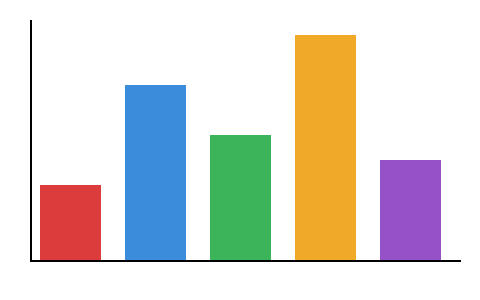
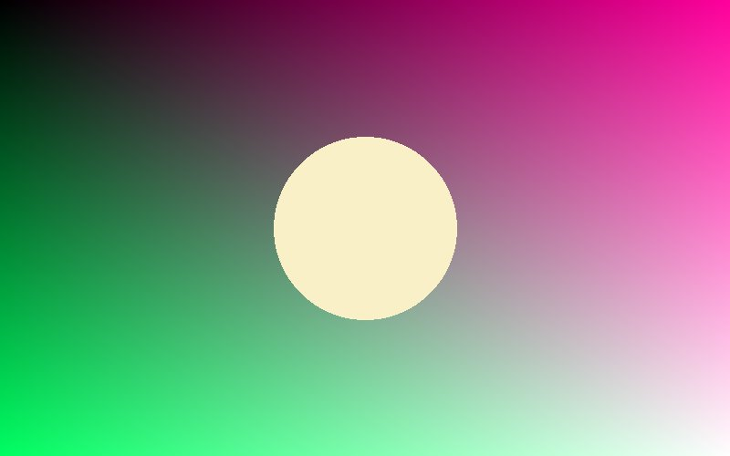

# Тестовая книга

Эта книга проверяет **всё форматирование** читалки: *курсив*, **жирный**, ***жирный курсив***, `код в строке` и обычный текст. Длинные слова вроде «электрификация», «высокопроизводительный» и «достопримечательность» переносятся по слогам. Число и единица не разрываются: 10 кг, 250 мм, 3 км.

English text works the same way: **bold**, *italic*, `inline code`. Hyphenation applies to incomprehensibilities and internationalization as well.

## Списки

Маркированный список:

- первый пункт
- второй пункт, достаточно длинный, чтобы перенестись на следующую строку и показать висячий отступ
  - вложенный пункт
  - ещё один вложенный
    - третий уровень
- третий пункт

Нумерованный список:

1. Открыть книгу.
2. Найти нужную главу в оглавлении и перейти к ней.
3. Читать.

## Цитаты и код

> Читать — вот лучшее учение.
>
> — *А. С. Пушкин*

```
int main(void) {
	printf("hello, world\n");
	return 0; /* a very long comment that does not fit into one line of the screen */
}
```

---

## Таблицы

Узкая таблица:

| Слово | Перевод | Ур. |
|---|---|---|
| book | книга | A1 |
| reliable | надёжный | B1 |
| thorough | тщательный | B2 |

Таблица «термин — значение»:

| Термин | Значение |
|---|---|
| Абзац | часть текста от одной красной строки до другой, обычно из нескольких предложений |
| Колонтитул | строка над или под основным текстом страницы с названием книги или главы |
| Кегль | размер шрифта, измеряется в пунктах |

Широкая таблица:

| Год | Январь | Февраль | Март | Апрель | Май | Июнь | Июль | Август |
|---|---|---|---|---|---|---|---|---|
| 2024 | 120 | 135 | 150 | 160 | 171 | 180 | 199 | 205 |
| 2025 | 210 | 222 | 240 | 251 | 260 | 275 | 280 | 297 |

## Формулы

Простая формула в строке: $x^2 + y^2 = r^2$, и посложнее: $\frac{a}{b} + \sqrt{x}$ внутри текста.

Выносная формула:

$$\int_0^1 x^2\,dx = \frac{1}{3}$$

$$E = mc^2$$

$$\sum_{k=1}^{n} k = \frac{n(n+1)}{2}$$

## Картинки



*Рис. 1. Столбчатая диаграмма*

Фотография шире экрана:



Маленькая картинка остаётся своего размера:


# Вторая глава

Вторая глава начинается с новой страницы. Здесь проверяется оглавление и переход по нему.

### Подраздел третьего уровня

Текст подраздела.

# Длинные таблицы

Длинная таблица переносится на следующие страницы, шапка повторяется.

| № | Слово | Перевод |
|---|---|---|
| 1 | apple | яблоко |
| 2 | bread | хлеб |
| 3 | cheese | сыр |
| 4 | door | дверь |
| 5 | egg | яйцо |
| 6 | fish | рыба |
| 7 | garden | сад |
| 8 | house | дом |
| 9 | island | остров |
| 10 | jacket | куртка |
| 11 | kitchen | кухня |
| 12 | lemon | лимон |
| 13 | market | рынок |
| 14 | night | ночь |
| 15 | orange | апельсин |
| 16 | pencil | карандаш |
| 17 | queen | королева |
| 18 | river | река |
| 19 | street | улица |
| 20 | table | стол |
| 21 | umbrella | зонт |
| 22 | village | деревня |
| 23 | window | окно |
| 24 | yellow | жёлтый |
| 25 | zebra | зебра |
| 26 | answer | ответ |
| 27 | bridge | мост |
| 28 | cloud | облако |
| 29 | dream | мечта |
| 30 | energy | энергия |

## Ячейки в несколько строк

| Термин | Пояснение | Пример |
|---|---|---|
| Подлежащее | главный член предложения, отвечает на вопрос «кто?» или «что?» | **Кот** спит |
| Сказуемое | главный член, что делает подлежащее | Кот **спит** |

## Таблица умножения

Шире экрана и выше страницы: на странице она уменьшена, по нажатию `5` открывается целиком.

| × | 1 | 2 | 3 | 4 | 5 | 6 | 7 | 8 | 9 | 10 | 11 | 12 |
|---|---|---|---|---|---|---|---|---|---|---|---|---|
| 1 | 1 | 2 | 3 | 4 | 5 | 6 | 7 | 8 | 9 | 10 | 11 | 12 |
| 2 | 2 | 4 | 6 | 8 | 10 | 12 | 14 | 16 | 18 | 20 | 22 | 24 |
| 3 | 3 | 6 | 9 | 12 | 15 | 18 | 21 | 24 | 27 | 30 | 33 | 36 |
| 4 | 4 | 8 | 12 | 16 | 20 | 24 | 28 | 32 | 36 | 40 | 44 | 48 |
| 5 | 5 | 10 | 15 | 20 | 25 | 30 | 35 | 40 | 45 | 50 | 55 | 60 |
| 6 | 6 | 12 | 18 | 24 | 30 | 36 | 42 | 48 | 54 | 60 | 66 | 72 |
| 7 | 7 | 14 | 21 | 28 | 35 | 42 | 49 | 56 | 63 | 70 | 77 | 84 |
| 8 | 8 | 16 | 24 | 32 | 40 | 48 | 56 | 64 | 72 | 80 | 88 | 96 |
| 9 | 9 | 18 | 27 | 36 | 45 | 54 | 63 | 72 | 81 | 90 | 99 | 108 |
| 10 | 10 | 20 | 30 | 40 | 50 | 60 | 70 | 80 | 90 | 100 | 110 | 120 |
| 11 | 11 | 22 | 33 | 44 | 55 | 66 | 77 | 88 | 99 | 110 | 121 | 132 |
| 12 | 12 | 24 | 36 | 48 | 60 | 72 | 84 | 96 | 108 | 120 | 132 | 144 |
| 13 | 13 | 26 | 39 | 52 | 65 | 78 | 91 | 104 | 117 | 130 | 143 | 156 |
| 14 | 14 | 28 | 42 | 56 | 70 | 84 | 98 | 112 | 126 | 140 | 154 | 168 |
| 15 | 15 | 30 | 45 | 60 | 75 | 90 | 105 | 120 | 135 | 150 | 165 | 180 |
| 16 | 16 | 32 | 48 | 64 | 80 | 96 | 112 | 128 | 144 | 160 | 176 | 192 |
| 17 | 17 | 34 | 51 | 68 | 85 | 102 | 119 | 136 | 153 | 170 | 187 | 204 |
| 18 | 18 | 36 | 54 | 72 | 90 | 108 | 126 | 144 | 162 | 180 | 198 | 216 |
| 19 | 19 | 38 | 57 | 76 | 95 | 114 | 133 | 152 | 171 | 190 | 209 | 228 |
| 20 | 20 | 40 | 60 | 80 | 100 | 120 | 140 | 160 | 180 | 200 | 220 | 240 |
| 21 | 21 | 42 | 63 | 84 | 105 | 126 | 147 | 168 | 189 | 210 | 231 | 252 |
| 22 | 22 | 44 | 66 | 88 | 110 | 132 | 154 | 176 | 198 | 220 | 242 | 264 |
| 23 | 23 | 46 | 69 | 92 | 115 | 138 | 161 | 184 | 207 | 230 | 253 | 276 |
| 24 | 24 | 48 | 72 | 96 | 120 | 144 | 168 | 192 | 216 | 240 | 264 | 288 |
| 25 | 25 | 50 | 75 | 100 | 125 | 150 | 175 | 200 | 225 | 250 | 275 | 300 |
| 26 | 26 | 52 | 78 | 104 | 130 | 156 | 182 | 208 | 234 | 260 | 286 | 312 |
| 27 | 27 | 54 | 81 | 108 | 135 | 162 | 189 | 216 | 243 | 270 | 297 | 324 |
| 28 | 28 | 56 | 84 | 112 | 140 | 168 | 196 | 224 | 252 | 280 | 308 | 336 |
| 29 | 29 | 58 | 87 | 116 | 145 | 174 | 203 | 232 | 261 | 290 | 319 | 348 |
| 30 | 30 | 60 | 90 | 120 | 150 | 180 | 210 | 240 | 270 | 300 | 330 | 360 |

Текст после таблицы.

# Фразовые глаголы

She tried to stop smoking many times, and at last she gave it up. Then he cut the old rope off with a knife. We look forward to the holidays.
